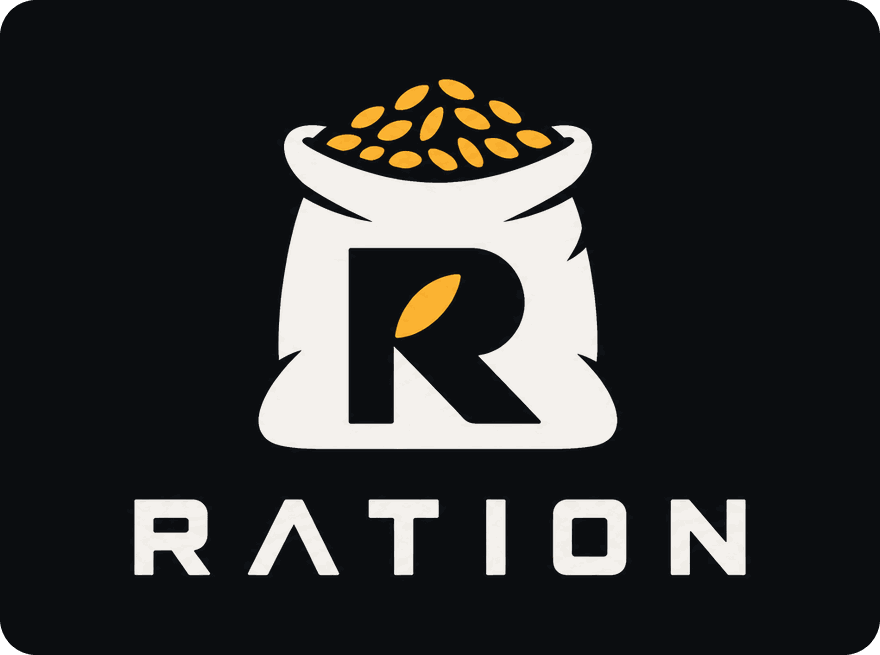

<div align="center">



**Spend intelligence where it matters.**

The inference control plane for coding agents.

[](https://github.com/KNambiarDJsc/Ration/actions/workflows/ci.yml)
[](https://github.com/KNambiarDJsc/Ration/releases)
[](LICENSE)


</div>

> Long sessions are where your quota goes.

Every message you send re-reads your whole conversation. At 900k tokens of context, one message costs about **10x** what it does at 90k, and Claude Code's default lets context grow to ~1M before it compacts. RATION shows where your usage went, finds the one official setting that fixes most of it, and makes starting fresh painless. Everything runs locally and reads only what Claude Code already writes to disk.

## The 60-second version

Requires Python 3.11+ and [Claude Code](https://code.claude.com). Install from GitHub. **Do not `pip install ration`: that name on PyPI is an unrelated package.**

```bash
uv tool install git+https://github.com/KNambiarDJsc/Ration   # or: pipx install git+https://github.com/KNambiarDJsc/Ration

ration governor    # the cheapest safe auto-compact window for how you work, from your own sessions
ration xray        # where the rest of your usage went, and what to change
ration handoff     # a restart kit, so /clear doesn't lose the thread
```

Those three need no setup, change nothing, and make no model calls. For in-session tips, a status line and live stuck detection:

```bash
ration init        # asks before changing anything, backs up your settings
```

Its objective is not "minimize tokens". It is **maximize verified useful engineering work per unit of scarce inference.**

## The big lever: `ration governor`

Every message re-reads your whole context. At 900k tokens, one message costs roughly **10x** what it does at 90k (about 0.5% vs 0.05% of a 5-hour window, calibrated on a real machine). Claude Code's default is to compact at **~967k** on 1M-window models, and after a compaction the context lands near the same ~85k whether it was 220k or 930k. Waiting longer only makes every message more expensive.

`ration governor` replays your *real* sessions under different auto-compact windows and tells you the cheapest one that is still safe:

```text
$ ration governor
Auto-compact window now: 967k (Claude Code default). Largest context you reached: 962k.
After a compaction your context lands near 85k.
One message costs about 0.53% of your 5-hour window at 962k context, vs 0.09% at 100k.

 window │ saves (measured) │ saves (worst case) │ compactions
 150k   │ +38%             │ compacts too often │ 69
 200k   │ +45%             │ compacts too often │ 30
 250k   │ +45%             │ -9%                │ 18
 300k   │ +41%             │ +23%               │ 14
 400k   │ +35%             │ +26%               │ 7    ◀ recommended
 500k   │ +30%             │ +24%               │ 6
Model check: replaying your current window reproduces your real usage to within 1%

Recommendation: 400k  est. saving 26% to 35% of your usage
```

It picks the window that saves the most under *pessimistic* assumptions, not the theoretical optimum, because the cheapest window in theory compacts every few calls if the post-compaction size is larger than measured. If you don't have long sessions, it says "no change recommended".

**What a live test showed** (Claude Code 2.1.296, haiku, window forced to 100k):

- Auto-compaction fired at the configured window, so the setting does what it says.
- The context came back at **120k, above the 100k window**: Claude Code preserves the most recent messages, and those were large. A window that small would compact again and again. This is the failure the "compacts too often" check exists to prevent.
- The compaction request itself was billed as about **118k fresh, uncached input tokens**, not at the cheap cached rate, and it does not appear in the session transcript. The "measured" column prices it that way.

> **Read this before applying.** The savings are a replay of past sessions, not a measurement of the future. Claude Code's own `/autocompact` text says the `auto` window (1M on current models) is "strongly recommended for the best cost and performance" and that overriding it "may result in high token usage, especially when resuming long sessions", and the live test above shows why a window that is too small backfires. The worst case already assumes a 1.5x larger post-compaction context, 100k tokens re-fetched each time and a fully uncached compaction request. The first message into an existing session above the new window triggers one large compaction. Use `ration governor status` to see what actually happened on your machine, and `ration governor revert` if it didn't pay off.

```bash
ration governor apply      # writes autoCompactWindow (backed up); or /autocompact 400k in Claude Code
ration governor status     # real before/after: usage per call, average context, compactions per 100 calls
ration governor revert     # restore your previous setting
```

In the session you also get a price tag in the status line once context is large (`782k in context · next msg ≈0.5% of 5h`) and a nudge to compact at a natural boundary (tests just went green) rather than mid-task. Design, model and limits: [docs/design/governor.md](docs/design/governor.md).

## Where did my quota go? `ration xray`

Claude Code tells you *how much* you've used. It can't tell you *why*. `ration xray` reads your past sessions (read-only, local, no model calls, message content never read) and answers that:

```text
$ ration xray --days 14
What the tokens were
  re-reading context         ██████████████████████░░░░░░  79%
  writing new context        ████░░░░░░░░░░░░░░░░░░░░░░░░  13%
  model output               ██░░░░░░░░░░░░░░░░░░░░░░░░░░   8%

Biggest sessions
   82%  my-agent-project       7f3a91c2  249.7h · 1209 calls · peak context 962k

What to change  (biggest first)
  1. Long contexts: up to 57% of your usage was re-reading context above 120k
     → /compact (or /clear with a short summary) once a session passes ~120k.
  2. Idle rebuilds: 8% of usage re-created context after you stepped away (11 times, 10 after an hour or more)
     → Before leaving a big session for more than a few minutes, /compact it, or start fresh with a 3-line summary.
  3. One session used 82% of everything: 250h open, peak context 962k
     → Close the thread when a task is done and start the next one fresh.
```

That output is from a real machine. The point: most quota isn't spent on *thinking*, it's spent on **re-reading a huge warm context on every call**, and on **rebuilding it after you walk away**. Those are habits, and habits are fixable. Every finding states whether it's measured or an upper-bound estimate, and with what assumption.

RATION also acts at the moment you can still choose. When you resume an old session whose cache has expired:

```text
RATION: resuming rebuilds ~142k tokens of context after 5h00m idle (about $0.89 at list price),
before your first reply. If you only need the gist, start fresh (/clear) with a 3-line summary
of where you were, or run /compact first. If you need the full thread, carry on.
```

## `/clear` without amnesia: `ration handoff`

The X-ray finds the cause (huge sessions re-reading huge contexts), but people keep those sessions alive because `/clear` loses the thread and `/compact` costs a model call and is lossy. `ration handoff` removes the excuse. It builds a **restart kit** from the session's record and your repo's real git state. **No model is used**, so it's free, instant, and can't hallucinate:

```text
$ ration handoff
# Restart kit: shop (session 7f3a91c2, 12 min ago, context was 212k tokens)

## Goal
fix the flaky refresh in src/auth.py, tests in tests/test_auth.py must pass
Recent asks:
- try a lock around the token cache

## State of the repo
Branch: `fix/auth-refresh`
     M src/auth.py
    ?? tests/test_refresh_race.py
Diff: 1 file changed, 14 insertions(+), 3 deletions(-)

## What happened
- Changed: `src/auth.py` (x4)
- Last test run: `pytest -q tests/test_auth.py` → 9 passed, 2 failed; failing: test_refresh_race
- 1 tool call(s) were denied by permissions (check your allow rules before retrying).

## Where it left off
> I added a lock; two tests still fail because the refresh future is shared. Next: make the future per-request.

## Next
Continue from "Where it left off". Verify with `pytest -q tests/test_auth.py`.
```

```bash
ration handoff --copy        # then /clear and paste: ~700 tokens instead of a 200k context
ration handoff --auto on     # opt in: after /clear, RATION adds the kit to the new session itself
```

When a session's context passes ~150k tokens, the advisor suggests exactly this. It's a map, not the full history: the new session re-reads the files it needs instead of dragging everything along.

## In your Claude Code session

After `ration init` you don't need another terminal. Tips appear as Claude Code notices, are shown **only to you**, and **never enter the model's context** (they use the hook `systemMessage` channel):

```text
> fix the typo in the README quickstart section please
  RATION: this looks like a small edit: haiku should be enough (you're on claude-opus-5-5).
          `/model haiku` and `/effort low` save premium quota.

> find out why the websocket reconnect logic occasionally deadlocks
  RATION: this looks like hard debugging (race condition, deadlock): consider `/model opus`
          with high effort. A stronger first attempt is usually cheaper than several weak ones.

  RATION: at this pace you'll hit your 5-hour limit in ~40m (it resets in 2h00m).
  RATION: that turn used 7% of your 5-hour window (3 subagents, 41 tool calls).
  RATION: your weekly window still has 55% left and resets in 9h. Unused quota is lost at reset.

status line:  RATION · 5h 72% (reset 1h59m)  ⚠ 5h limit in ~40m
```

Each kind of tip is rate-limited, and model tips are withheld when RATION isn't confident about the task. `ration advisor off` silences all of it.

**How it stays accurate, with local data only (no APIs, no LLM calls):**

| Concern | How it's handled |
|---|---|
| Keyword guesses misread prompts | Every classification has a confidence, and model tips are **withheld when it's a guess**. The guess is corrected by the session (failing tests → debugging) and by **your own history in this repo** ("debugging turns here usually take ~45 tool calls"). |
| Needs a status line or a Pro/Max plan | Model and effort are read from the session transcript, so tips work with hooks alone. API-key users set `daily_usd` / `weekly_usd`; spend comes from Claude Code's own `cost.total_cost_usd`. |
| Usage % arrives late | Each turn's tokens are counted **exactly** from the transcript (de-duplicated, subagents included). The % is exact when a fresh reading exists, otherwise estimated from a usage-per-token rate **learned on your machine** and labelled `~… calibrated on this machine`. |
| Effort | Detected live (`effort.level`, transcript `effort`) and suggested as `/effort low|medium|high`. |

## Let RATION run a task

```bash
ration plan "find and fix why auth refresh occasionally deadlocks" --priority high   # explain, don't run
ration run  "fix the flaky checkout test" --check "pytest -q tests/test_checkout.py" --permission-mode acceptEdits
```

<p align="center"></p>

That's a real run (2026-10-10, Claude Code 2.1.296). The 5-hour window was under pressure, so RATION chose haiku at low effort, and that was enough.

What `ration run` does:

1. Runs your `--check` commands **before spending anything**. Already passing? Done, nothing spent.
2. Picks provider, model class, effort, max turns, retries and subagent allowance from task difficulty/risk/value and your **real** budget, and records every reason.
3. Runs the agent (`claude -p --output-format stream-json`, or `codex exec --json`), watching for stuck loops; a likely-stuck run is interrupted.
4. Verifies with your checks. No improvement → escalate one tier (cheap → strong → premium, premium only when justified). Progress → keep the model. Permission wall → stop and tell you why instead of retrying.

## Idle capacity: `ration autopilot`

You are about to step away, most of your 5-hour window is unused, and it resets in two hours. Autopilot (also `ration nightshift`) converts idle inference you chose to make available into verified, useful work. **It does not exist to use up quota.** It protects the weekly window first: if the week is tight it does nothing, however much of the short window is free, and if there is no worthwhile work it stops.

```bash
ration goal set "Ship the MVP" --priority "finish authentication" --constraint "don't change the database schema"   # optional

ration autopilot --dry-run                 # the plan and the reasons; starts no agent, changes nothing
ration autopilot --mode safe --max-tasks 3 # tests, lint and type fixes, docs, small local fixes. Asks before starting
ration autopilot status                    # from another terminal; also: ration autopilot stop
ration autopilot report                    # what was accepted, what was discarded and why, and what to review
```

A real run on this repository (2026-10-13, Claude Code 2.1.296; the scheduler chose haiku at low effort):

```text
▶ Add tests for scripts/gen_readme_assets.py  (score 74)
    claude · cheap model · effort low
  ✓ SUCCESS  7 more passing tests (133 passed, 0 failed → 140 passed, 0 failed)

Combined result (everything accepted, verified together in a clean checkout):
  base commit  `python -m pytest -p no:cacheprovider`: 133 passing, 0 failing
  combined     `python -m pytest -p no:cacheprovider`: 140 passing, 0 failing
  OK: no check is worse than at the base commit

To review (nothing was merged into your branches):
  git diff naman-development...ration/auto/20261013-014624-3421/accepted    # all accepted changes, 1 task(s)
```

An earlier attempt at the same task wrote tests of which two failed; it was reported as `REGRESSION` and discarded, with the diff kept for inspection.

How it stays safe:

- **Tasks come from local signals** (failing tests, lint, TODOs, untested modules, your backlog files, tasks you define), never from asking a model what to do next. Text in the repository is treated as data: a backlog line that reads like an instruction to the agent is rejected.
- **Every task works in its own git worktree**, starting from everything accepted before it, and is compared with a baseline. Better and nothing worse is committed to a `ration/auto/<run>/…` branch; anything else is discarded with the reason. At the end, everything accepted is verified again together.
- **Your checkout is never written to.** Nothing is merged into your branches, and nothing is pushed or deployed: git network access is switched off for the agent, and your branches and remotes are fingerprinted around every task.
- **You stay in charge.** Starting needs an explicit yes. `.ration/policy.toml` adds protected paths, denied categories, a weekly reserve and a task cap; it cannot switch the built-in protections off.

`--mode build` allows bounded feature work, `--mode research` writes read-only analysis. Design, safety model, trust boundaries and limits: [docs/autopilot-architecture.md](docs/autopilot-architecture.md).

## Watching usage and sessions

`ration status` shows each usage window, how fast you're burning it, and whether you'll run out before it resets. `ration watch` shows live sessions with a progress score and a stuck score, with the reasons.

<p align="center"></p>

<p align="center"></p>

## Commands

| Command | What it does |
|---|---|
| `ration governor [apply\|status\|revert] [--days N]` | Cheapest safe auto-compact window from your own sessions; apply it, check the real before/after, undo it |
| `ration init` | Detect agents, install hooks + status line (asks first, backs up settings) |
| `ration handoff [--copy] [--auto on\|off]` | Restart kit from a session + git state, so `/clear` doesn't lose the thread (no model call) |
| `ration xray [--days N]` | Where your usage went (context size, idle rebuilds, subagents, models) and what to change |
| `ration status` | Usage per window, burn pressure, reset forecast, recommendation |
| `ration watch` | Live view of sessions: progress, stuck score, reasons, suggestion |
| `ration plan "<task>"` | Show the scheduler's decision and reasons without running |
| `ration run "<task>" --check "<cmd>"` | Run a task with budget-aware model choice, verification and escalation |
| `ration autopilot [status\|stop\|report] [--dry-run] [--mode safe\|build\|research]` | Find, rank and run safe, verified work for idle capacity, on separate branches (also `ration nightshift`) |
| `ration goal [show\|set\|edit\|clear]` | The project goal, priorities and constraints autopilot ranks against (local, `.ration/goal.toml`) |
| `ration sessions` / `ration history` | Discovered sessions / tasks run through RATION |
| `ration providers` / `ration doctor` | Detected capabilities / installation health and hook latency |
| `ration privacy [--purge]` | Exactly what's stored locally; delete it all |
| `ration benchmark` | Reproducible routing simulation (A/B/C/D policies under equal budgets) |
| `ration advisor on\|off` | In-session tips |
| `ration guard on\|off` | Enforcement (default is observe-only) |
| `ration hooks install\|uninstall\|status`, `ration statusline install\|uninstall` | Manage the Claude Code integration |
| `ration snippet` | Print an optional AGENTS.md / CLAUDE.md fragment (never written for you) |

## How it works

```
                    RATION (local, SQLite)
                      │
       ┌──────────────┼──────────────┐
   Budget Engine   Scheduler     Progress / Stuck Engine
       └──────────────┼──────────────┘
               Provider Adapters
      ┌───────────────┼────────────────┐
 Claude Code        Codex          Generic CLI / Mock
 hooks, status line rollout logs   exit codes
 claude -p stream   codex exec --json
```

| Mode | What it does | How |
|---|---|---|
| **Analyze** (no setup) | `governor`, `xray` and `handoff` answer from your past sessions | Reads the session files Claude Code already writes; no hooks, no model calls |
| **Observe** (after `ration init`) | Records sessions, tool calls, tests, subagents, usage; advises | Claude Code command hooks + status line; Codex rollout logs |
| **Guard** (`ration guard on`) | Denies wasteful subagent spawns, injects stuck warnings | `PreToolUse` deny on the Agent tool; `additionalContext` after tool calls |
| **Schedule** (`ration run`) | Chooses and runs, verifies, escalates or stops | `claude -p --output-format stream-json`, `codex exec --json` |

**Reset-aware budgeting.** `burn_pressure = observed_burn / (remaining / time_to_reset)`. Above 1 you'll run out before the reset; below 1 quota will go unused. Pace is measured over ~10% of each window (30 min for the 5-hour window, ~17 h for the weekly one) so a burst of work doesn't cry wolf. Unused quota is only offered to queued useful work; RATION never burns quota for its own sake.

**Stuck detection.** Nine signals (repeated identical tool calls, repeated command sequences, the same failing test, failed-tool streaks, edit churn, unchanged re-reads, time without progress, compaction without progress, repeated delegation) combined with a noisy-OR into `stuck ∈ [0, 1]`:

| stuck | band | default suggestion |
|---|---|---|
| < 0.35 | healthy | continue |
| 0.35–0.65 | watch | continue, show reasons |
| 0.65–0.80 | intervene | replan / compact context / restart session / reduce parallelism |
| > 0.80 | likely stuck | escalate (valuable + budget) · stop (low value) · ask you |

**Scheduler.** Rule-based and explainable: `CHEAP_FIRST` for routine work, `STRONG_FIRST` for risky or hard debugging/architecture/migration, `PREMIUM_RESERVED` gating premium models. No RL and no learned routing yet. Every decision is logged as state/action/outcome for later research.

## Integrations

**Claude Code**
- Usage comes from official sources: the status line JSON (`rate_limits.five_hour` / `seven_day`, Pro/Max and gateway spend limits) and the `rate_limit_event` in `claude -p` stream output.
- Hooks are appended next to yours in `~/.claude/settings.json` (backed up first); uninstall removes only RATION's entries. Your existing status line keeps working (RATION wraps and prints it).
- Hooks are deterministic Python, **fail open** (an internal error never blocks your session), and add about 140 ms per tool call on the reference Windows machine, 54 ms of which is Python starting up (`ration doctor` measures yours).
- RATION never edits `CLAUDE.md`, permissions, auth or sandbox settings, never passes `bypassPermissions`, and never uses OAuth tokens or private endpoints.
- Optional plugin with slash commands (`/ration:autopilot`, `/ration:report`, `/ration:status`, `/ration:goal`) that call the installed CLI: `/plugin marketplace add KNambiarDJsc/Ration`, then `/plugin install ration@ration`. It adds no hooks; `ration init` still installs those and the status line, which a plugin cannot set.

**Codex**
- Usage from Codex's own rollout logs (`$CODEX_HOME/sessions/**/rollout-*.jsonl`, server-reported `rate_limits`), read-only.
- `ration run --provider codex` uses `codex exec --json`. RATION passes no sandbox or approval flags; your Codex config wins.

## Privacy and safety

- **All data stays on your machine** in SQLite (`~/.config/ration/ration.db`). There is no upload code path and no telemetry.
- **Stored:** event types, tool names, *hashes* of tool inputs, test runner names and pass/fail counts, token/cost numbers, usage percentages, file paths (can be turned off). For prompts: only length, estimated task type/difficulty, and usage % at submit time.
- **Never stored in the database:** source code, diffs, prompt text, full commands, tool output, credentials.
- **One deliberate exception, opt-in:** `ration handoff` reads message text at run time to write the restart kit, so it contains short excerpts of your prompts and the last reply. It's only printed/copied when you ask. With `handoff --auto on`, it's written to a local temp file (`~/.config/ration/handoffs/`) that is deleted as soon as the new session uses it, or after 30 minutes.
- **Autopilot, only when you run it:** the goal, run reports, research output and the redacted diffs of discarded changes are kept in the project's own `.ration/` folder, which ignores itself in git. Task descriptions (file names and line numbers, never code) go in the database like any `ration run` task.
- `ration privacy` shows exactly what's stored; `ration privacy --purge` deletes it.

## Configuration

`~/.config/ration/config.toml` (created by `ration init`), with per-project overrides in `.ration.toml`:

```toml
[budget]
reserve_percent = 20      # keep this much of a window for high-value work
daily_usd = 0             # API-key users: daily / weekly dollar budgets (0 = off)
weekly_usd = 0

[advisor]
enabled = true
receipt_min_percent = 2.0 # only show receipts for turns that cost >= 2% of the 5-hour window
quiet_minutes = 20        # don't repeat the same kind of tip within this window
price_tag_min_ctx = 150000     # status line shows the next message's price above this context size (0 = off)
compact_nudge_tokens = 250000  # suggest /compact when tests go green above this size (0 = off)
context_tip_tokens = 150000    # suggest a restart kit above this size (0 = off)

[handoff]
auto = false              # true: after /clear, add the restart kit to the new session
max_chars = 3000

[autopilot]
weekly_reserve_percent = 40      # optional work never takes the weekly window below this
max_weekly_percent_per_run = 10  # and one run never uses more of the week than this
max_tasks = 5
min_score = 50                   # tasks scoring below this aren't worth unattended quota
setup_command = ""               # run in each fresh worktree before its checks, e.g. "npm ci"
test_command = ""                # empty = detect (pytest, npm test, go test, cargo test, make test)

[guard]
mode = "observe"          # "guard" lets hooks deny subagent explosions / inject stuck warnings
max_subagents_per_task = 6
max_premium_subagents = 2

[claude]
cheap = "haiku"           # what cheap / strong / premium mean for `ration run` and tips
strong = "sonnet"
premium = "opus"
```

## Benchmarks

`ration benchmark` runs a reproducible **synthetic** world (100 tasks, 3 providers, identical weekly budgets, 5 seeds; parameters in [`src/ration/sim/bench.py`](src/ration/sim/bench.py)):

| policy | resolved /100 | value | units / resolved | stuck units | premium units | unused at reset | ran out early |
|---|---|---|---|---|---|---|---|
| A premium always | 88.0 | 42.9 | 10.08 | 178 | 887 | 23% | 2h |
| B cheapest always | 45.4 | 22.3 | 3.14 | 75 | 0 | 88% | 0h |
| C static routing | 88.0 | 43.3 | 7.43 | 232 | 506 | 43% | 4h |
| **D RATION adaptive** | 81.8 | 43.8 | **5.32** | 74 | 217 | 62% | 0h |
| D− RATION, no stuck interrupt | 82.0 | 44.7 | 6.71 | 217 | 226 | 52% | 0h |

Read honestly: in this world RATION delivers about the same task value (differences within seed noise) at ~28% lower cost per resolved task than static routing and ~47% lower than premium-always, and never runs a provider dry. It resolves fewer tasks because it deliberately stops low-value loops. Part of the saving comes from one assumption (stuck attempts cost 2× uninterrupted, 0.6× interrupted), which D− isolates. **This is not evidence about real agents**; a real-task benchmark is on the roadmap.

## FAQ

**Does it slow Claude Code down?** Each tool call runs a local hook: a median 140 ms on the reference Windows machine, of which 54 ms is Python starting up. `ration doctor` measures it on yours. `governor`, `xray` and `handoff` need no hooks at all.

**Does it send my code or prompts anywhere?** No. There is no network code at all; everything is local SQLite, and prompt text is never stored.

**Is this allowed with a Claude subscription?** RATION only reads what Claude Code itself exposes locally (hooks, status line, session files) and launches the official `claude` CLI. It never touches credentials, OAuth tokens or private endpoints.

**I use an API key, not Pro/Max.** Set `daily_usd` / `weekly_usd` in `[budget]`; budgets, warnings and receipts then work in dollars.

**It's too chatty / not chatty enough.** Tune `[advisor]`, or `ration advisor off`.

## Uninstall

```bash
ration hooks uninstall        # removes only RATION's hooks
ration statusline uninstall   # restores your previous status line
uv tool uninstall ration      # or: pipx uninstall ration
```

Your data is in `~/.config/ration/` (delete it, or `ration privacy --purge` first).

## Project status

**Alpha (v0.2).** Built and tested on Windows with Claude Code 2.1.296; CI runs the test suite on Linux, macOS and Windows.

Seen working in real Claude Code sessions: hooks and status line, usage capture, `ration run` fixing a real failing-test repo, model/limit tips, the resume-cost tip (it predicted a 43k-token rebuild; Claude Code then billed 42,674), the compact nudge at a green-test boundary, the restart kit carried into a new session after `/clear`, and auto-compaction firing at a configured window.

Known gaps:
- **The governor's saving is an estimate.** It is a replay of one heavy user's history. The mechanics are verified live; a multi-day before/after is not yet in.
- **Compaction requests are invisible to RATION.** Claude Code bills them but doesn't write them to the session transcript, so RATION's per-turn token counts and `xray` shares leave them out (a few percent of usage on the reference machine).
- The **Codex adapter** follows the open-source `codex-rs` protocol and is unit-tested against its formats, but hasn't been run against a live Codex install yet.
- Session transcripts are an internal Claude Code format: read defensively, verified on 2.1.296, may need updates as Claude Code evolves.
- Task difficulty is keyword heuristics corrected by your own history; no ML.
- **Autopilot** is tested with a scripted agent (including hostile ones) and has run real Claude Code tasks on Windows, on this repository among others. Long multi-hour unattended runs are not measured yet, and the Codex path has never been run against an installed Codex. Start with `--dry-run` and `--max-tasks 1`.

## Roadmap

- Governor results from more machines, and a multi-day before/after on the reference one
- A PyPI release under a distribution name that isn't taken (`ration` is)
- Real-task benchmark suite (controlled repos with acceptance checks; SWE-bench-style adapter)
- Codex lifecycle hooks and live Codex validation
- Gemini CLI and OpenAI-compatible / local-model adapters
- Optional MCP server (`ration_get_budget`, `ration_request_escalation`, …); the core never depends on it
- A Textual dashboard once the core loop has proven itself
- Learned allocation policies, trained on the state/action/outcome log RATION already records

## Research

Every scheduler decision is logged as **state** (budgets, reset times, task features, attempts, stuck/progress), **action** (provider, model class, effort, parallelism, intervention) and **outcome** (completed, checks, cost, wall time). The open question: *can learned compute-allocation policies beat static routing under real quota constraints?* RATION is built to answer it with data.

## Contributing

Issues and PRs welcome; see [CONTRIBUTING.md](CONTRIBUTING.md). Architecture notes: [docs/architecture.md](docs/architecture.md), provider research: [docs/provider-capabilities.md](docs/provider-capabilities.md).

## License

[MIT](LICENSE)
