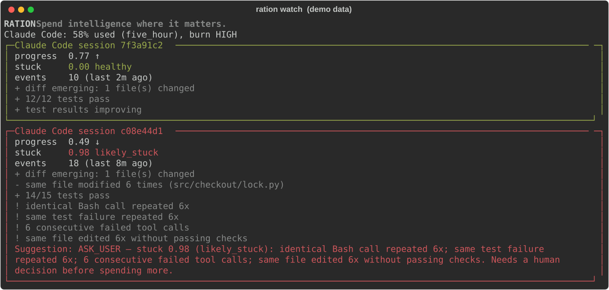
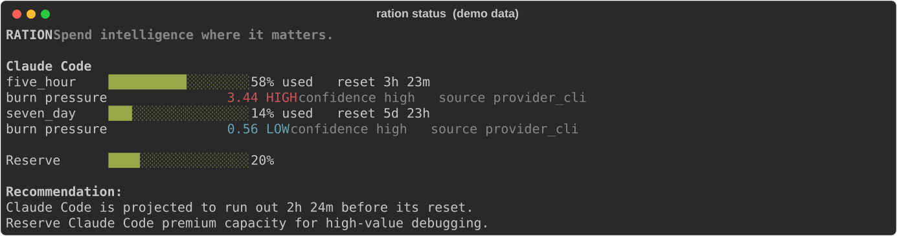
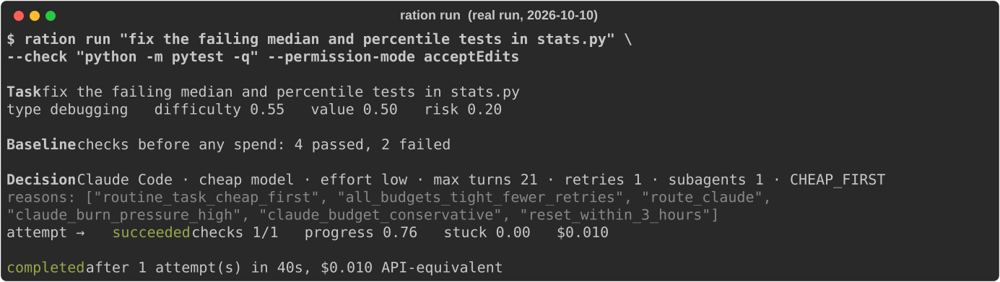

<div align="center">

# RATION

**Spend intelligence where it matters.**

The inference control plane for coding agents.

[](https://github.com/KNambiarDJsc/Ration/actions/workflows/ci.yml)
[](LICENSE)


</div>

> Your coding agents have a spending problem.

You run Claude Code (and Codex) all day: long sessions, subagents, retries, test loops. Then you hit your 5-hour limit mid-task with no warning, and you never learn which turn burned it.

RATION sits **above** your coding agents. It watches what they actually do, reads the official usage numbers they already report, and tells you **when to spend, save, escalate or stop**: in your Claude Code session, in your status line, and in a scheduler that can run tasks for you.

<p align="center"></p>

## What you get

- **An X-ray of where your quota went.** Claude shows a percentage; RATION shows *why*: which sessions, which habits, and what to change. It works on day one from the session files already on your disk. See below.
- **Warnings before you hit the wall.** *"At this pace you'll hit your 5-hour limit in ~40m (it resets in 2h00m)."* Measured from your real pace, in Claude Code and in your status line.
- **The right model for the task you just typed.** *"This looks like a small edit: haiku should be enough (you're on opus). `/model haiku` and `/effort low` save premium quota."* It never switches anything for you.
- **Receipts.** *"That turn used 7% of your 5-hour window (3 subagents, 41 tool calls)."* Exact token counts from your session files.
- **Stuck detection.** Same test failing six times, the same commands in a loop, files re-read with no change: scored, explained, and (if you opt in) interrupted.
- **A scheduler that starts cheap and escalates only on verified progress.** `ration run` checks your tests before spending anything, picks model/effort/retries from your real budget, and stops wasting quota on loops.

Its objective is not "minimize tokens". It is **maximize verified useful engineering work per unit of scarce inference.**

## Quickstart

Requires Python 3.11+ and [Claude Code](https://code.claude.com). Not on PyPI yet; install from GitHub:

```bash
uv tool install git+https://github.com/KNambiarDJsc/Ration
# or: pipx install git+https://github.com/KNambiarDJsc/Ration

ration init      # detects Claude Code / Codex, asks before changing anything, backs up settings
```

Then start a **new** `claude` session and work as usual. RATION observes, and speaks up only when it matters.

```bash
ration status    # 5-hour / weekly usage, burn pressure, reset forecast
ration watch     # live progress + stuck detection for running sessions
ration doctor    # check hooks, status line, latency
```

<p align="center"></p>

## Where did my quota go? `ration xray`

Claude Code tells you *how much* you've used. It can't tell you *why*. `ration xray` reads your past sessions (read-only, local, no model calls, message content never read) and answers that:

```text
$ ration xray --days 14
What the tokens were
  re-reading context         ██████████████████████░░░░░░  79%
  writing new context        ████░░░░░░░░░░░░░░░░░░░░░░░░  13%
  model output               ██░░░░░░░░░░░░░░░░░░░░░░░░░░   8%

Biggest sessions
   82%  my-agent-project       7f3a91c2  249.7h · 1209 calls · peak context 962k

What to change  (biggest first)
  1. Long contexts: up to 57% of your usage was re-reading context above 120k
     → /compact (or /clear with a short summary) once a session passes ~120k.
  2. Idle rebuilds: 8% of usage re-created context after you stepped away (11 times, 10 after an hour or more)
     → Before leaving a big session for more than a few minutes, /compact it, or start fresh with a 3-line summary.
  3. One session used 82% of everything: 250h open, peak context 962k
     → Close the thread when a task is done and start the next one fresh.
```

That output is from a real machine. The point: most quota isn't spent on *thinking*, it's spent on **re-reading a huge warm context on every call**, and on **rebuilding it after you walk away**. Those are habits, and habits are fixable. Every finding states whether it's measured or an upper-bound estimate, and with what assumption.

RATION also acts at the moment you can still choose. When you resume an old session whose cache has expired:

```text
RATION: resuming rebuilds ~142k tokens of context after 5h00m idle (about $0.89 at list price),
before your first reply. If you only need the gist, start fresh (/clear) with a 3-line summary
of where you were, or run /compact first. If you need the full thread, carry on.
```

## `/clear` without amnesia: `ration handoff`

The X-ray finds the cause (huge sessions re-reading huge contexts), but people keep those sessions alive because `/clear` loses the thread and `/compact` costs a model call and is lossy. `ration handoff` removes the excuse. It builds a **restart kit** from the session's record and your repo's real git state. **No model is used**, so it's free, instant, and can't hallucinate:

```text
$ ration handoff
# Restart kit: shop (session 7f3a91c2, 12 min ago, context was 212k tokens)

## Goal
fix the flaky refresh in src/auth.py, tests in tests/test_auth.py must pass
Recent asks:
- try a lock around the token cache

## State of the repo
Branch: `fix/auth-refresh`
     M src/auth.py
    ?? tests/test_refresh_race.py
Diff: 1 file changed, 14 insertions(+), 3 deletions(-)

## What happened
- Changed: `src/auth.py` (x4)
- Last test run: `pytest -q tests/test_auth.py` → 9 passed, 2 failed; failing: test_refresh_race
- 1 tool call(s) were denied by permissions (check your allow rules before retrying).

## Where it left off
> I added a lock; two tests still fail because the refresh future is shared. Next: make the future per-request.

## Next
Continue from "Where it left off". Verify with `pytest -q tests/test_auth.py`.
```

```bash
ration handoff --copy        # then /clear and paste: ~700 tokens instead of a 200k context
ration handoff --auto on     # opt in: after /clear, RATION adds the kit to the new session itself
```

When a session's context passes ~150k tokens, the advisor suggests exactly this. It's a map, not the full history: the new session re-reads the files it needs instead of dragging everything along.

## In your Claude Code session

After `ration init` you don't need another terminal. Tips appear as Claude Code notices, are shown **only to you**, and **never enter the model's context** (they use the hook `systemMessage` channel):

```text
> fix the typo in the README quickstart section please
  RATION: this looks like a small edit: haiku should be enough (you're on claude-opus-5-5).
          `/model haiku` and `/effort low` save premium quota.

> find out why the websocket reconnect logic occasionally deadlocks
  RATION: this looks like hard debugging (race condition, deadlock): consider `/model opus`
          with high effort. A stronger first attempt is usually cheaper than several weak ones.

  RATION: at this pace you'll hit your 5-hour limit in ~40m (it resets in 2h00m).
  RATION: that turn used 7% of your 5-hour window (3 subagents, 41 tool calls).
  RATION: your weekly window still has 55% left and resets in 9h. Unused quota is lost at reset.

status line:  RATION · 5h 72% (reset 1h59m)  ⚠ 5h limit in ~40m
```

Each kind of tip is rate-limited, and model tips are withheld when RATION isn't confident about the task. `ration advisor off` silences all of it.

**How it stays accurate, with local data only (no APIs, no LLM calls):**

| Concern | How it's handled |
|---|---|
| Keyword guesses misread prompts | Every classification has a confidence, and model tips are **withheld when it's a guess**. The guess is corrected by the session (failing tests → debugging) and by **your own history in this repo** ("debugging turns here usually take ~45 tool calls"). |
| Needs a status line or a Pro/Max plan | Model and effort are read from the session transcript, so tips work with hooks alone. API-key users set `daily_usd` / `weekly_usd`; spend comes from Claude Code's own `cost.total_cost_usd`. |
| Usage % arrives late | Each turn's tokens are counted **exactly** from the transcript (de-duplicated, subagents included). The % is exact when a fresh reading exists, otherwise estimated from a usage-per-token rate **learned on your machine** and labelled `~… calibrated on this machine`. |
| Effort | Detected live (`effort.level`, transcript `effort`) and suggested as `/effort low|medium|high`. |

## Let RATION run a task

```bash
ration plan "find and fix why auth refresh occasionally deadlocks" --priority high   # explain, don't run
ration run  "fix the flaky checkout test" --check "pytest -q tests/test_checkout.py" --permission-mode acceptEdits
```

<p align="center"></p>

That's a real run (2026-10-10, Claude Code 2.1.296). The 5-hour window was under pressure, so RATION chose haiku at low effort, and that was enough.

What `ration run` does:

1. Runs your `--check` commands **before spending anything**. Already passing? Done, nothing spent.
2. Picks provider, model class, effort, max turns, retries and subagent allowance from task difficulty/risk/value and your **real** budget, and records every reason.
3. Runs the agent (`claude -p --output-format stream-json`, or `codex exec --json`), watching for stuck loops; a likely-stuck run is interrupted.
4. Verifies with your checks. No improvement → escalate one tier (cheap → strong → premium, premium only when justified). Progress → keep the model. Permission wall → stop and tell you why instead of retrying.

## Commands

| Command | What it does |
|---|---|
| `ration init` | Detect agents, install hooks + status line (asks first, backs up settings) |
| `ration handoff [--copy] [--auto on\|off]` | Restart kit from a session + git state, so `/clear` doesn't lose the thread (no model call) |
| `ration xray [--days N]` | Where your usage went (context size, idle rebuilds, subagents, models) and what to change |
| `ration status` | Usage per window, burn pressure, reset forecast, recommendation |
| `ration watch` | Live view of sessions: progress, stuck score, reasons, suggestion |
| `ration plan "<task>"` | Show the scheduler's decision and reasons without running |
| `ration run "<task>" --check "<cmd>"` | Run a task with budget-aware model choice, verification and escalation |
| `ration sessions` / `ration history` | Discovered sessions / tasks run through RATION |
| `ration providers` / `ration doctor` | Detected capabilities / installation health and hook latency |
| `ration privacy [--purge]` | Exactly what's stored locally; delete it all |
| `ration benchmark` | Reproducible routing simulation (A/B/C/D policies under equal budgets) |
| `ration advisor on\|off` | In-session tips |
| `ration guard on\|off` | Enforcement (default is observe-only) |
| `ration hooks install\|uninstall\|status`, `ration statusline install\|uninstall` | Manage the Claude Code integration |
| `ration snippet` | Print an optional AGENTS.md / CLAUDE.md fragment (never written for you) |

## How it works

```
                    RATION (local, SQLite)
                      │
       ┌──────────────┼──────────────┐
   Budget Engine   Scheduler     Progress / Stuck Engine
       └──────────────┼──────────────┘
               Provider Adapters
      ┌───────────────┼────────────────┐
 Claude Code        Codex          Generic CLI / Mock
 hooks, status line rollout logs   exit codes
 claude -p stream   codex exec --json
```

| Mode | What it does | How |
|---|---|---|
| **Observe** (default) | Records sessions, tool calls, tests, subagents, usage; advises | Claude Code command hooks + status line; Codex rollout logs |
| **Guard** (`ration guard on`) | Denies wasteful subagent spawns, injects stuck warnings | `PreToolUse` deny on the Agent tool; `additionalContext` after tool calls |
| **Schedule** (`ration run`) | Chooses and runs, verifies, escalates or stops | `claude -p --output-format stream-json`, `codex exec --json` |

**Reset-aware budgeting.** `burn_pressure = observed_burn / (remaining / time_to_reset)`. Above 1 you'll run out before the reset; below 1 quota will go unused. Pace is measured over ~10% of each window (30 min for the 5-hour window, ~17 h for the weekly one) so a burst of work doesn't cry wolf. Unused quota is only offered to queued useful work; RATION never burns quota for its own sake.

**Stuck detection.** Nine signals (repeated identical tool calls, repeated command sequences, the same failing test, failed-tool streaks, edit churn, unchanged re-reads, time without progress, compaction without progress, repeated delegation) combined with a noisy-OR into `stuck ∈ [0, 1]`:

| stuck | band | default suggestion |
|---|---|---|
| < 0.35 | healthy | continue |
| 0.35–0.65 | watch | continue, show reasons |
| 0.65–0.80 | intervene | replan / compact context / restart session / reduce parallelism |
| > 0.80 | likely stuck | escalate (valuable + budget) · stop (low value) · ask you |

**Scheduler.** Rule-based and explainable: `CHEAP_FIRST` for routine work, `STRONG_FIRST` for risky or hard debugging/architecture/migration, `PREMIUM_RESERVED` gating premium models. No RL, no learned routing in v0.1. Every decision is logged as state/action/outcome for later research.

## Integrations

**Claude Code**
- Usage comes from official sources: the status line JSON (`rate_limits.five_hour` / `seven_day`, Pro/Max and gateway spend limits) and the `rate_limit_event` in `claude -p` stream output.
- Hooks are appended next to yours in `~/.claude/settings.json` (backed up first); uninstall removes only RATION's entries. Your existing status line keeps working (RATION wraps and prints it).
- Hooks are deterministic Python, **fail open** (an internal error never blocks your session), and add roughly 100–200 ms per tool call (`ration doctor` measures yours).
- RATION never edits `CLAUDE.md`, permissions, auth or sandbox settings, never passes `bypassPermissions`, and never uses OAuth tokens or private endpoints.

**Codex**
- Usage from Codex's own rollout logs (`$CODEX_HOME/sessions/**/rollout-*.jsonl`, server-reported `rate_limits`), read-only.
- `ration run --provider codex` uses `codex exec --json`. RATION passes no sandbox or approval flags; your Codex config wins.

## Privacy and safety

- **All data stays on your machine** in SQLite (`~/.config/ration/ration.db`). There is no upload code path and no telemetry.
- **Stored:** event types, tool names, *hashes* of tool inputs, test runner names and pass/fail counts, token/cost numbers, usage percentages, file paths (can be turned off). For prompts: only length, estimated task type/difficulty, and usage % at submit time.
- **Never stored in the database:** source code, diffs, prompt text, full commands, tool output, credentials.
- **One deliberate exception, opt-in:** `ration handoff` reads message text at run time to write the restart kit, so it contains short excerpts of your prompts and the last reply. It's only printed/copied when you ask. With `handoff --auto on`, it's written to a local temp file (`~/.config/ration/handoffs/`) that is deleted as soon as the new session uses it, or after 30 minutes.
- `ration privacy` shows exactly what's stored; `ration privacy --purge` deletes it.

## Configuration

`~/.config/ration/config.toml` (created by `ration init`), with per-project overrides in `.ration.toml`:

```toml
[budget]
reserve_percent = 20      # keep this much of a window for high-value work
daily_usd = 0             # API-key users: daily / weekly dollar budgets (0 = off)
weekly_usd = 0

[advisor]
enabled = true
receipt_min_percent = 2.0 # only show receipts for turns that cost >= 2% of the 5-hour window
quiet_minutes = 20        # don't repeat the same kind of tip within this window

[guard]
mode = "observe"          # "guard" lets hooks deny subagent explosions / inject stuck warnings
max_subagents_per_task = 6
max_premium_subagents = 2

[claude]
cheap = "haiku"           # what cheap / strong / premium mean for `ration run` and tips
strong = "sonnet"
premium = "opus"
```

## Benchmarks

`ration benchmark` runs a reproducible **synthetic** world (100 tasks, 3 providers, identical weekly budgets, 5 seeds; parameters in [`src/ration/sim/bench.py`](src/ration/sim/bench.py)):

| policy | resolved /100 | value | units / resolved | stuck units | premium units | unused at reset | ran out early |
|---|---|---|---|---|---|---|---|
| A premium always | 88.0 | 42.9 | 10.08 | 178 | 887 | 23% | 2h |
| B cheapest always | 45.4 | 22.3 | 3.14 | 75 | 0 | 88% | 0h |
| C static routing | 88.0 | 43.3 | 7.43 | 232 | 506 | 43% | 4h |
| **D RATION adaptive** | 81.8 | 43.8 | **5.32** | 74 | 217 | 62% | 0h |
| D− RATION, no stuck interrupt | 82.0 | 44.7 | 6.71 | 217 | 226 | 52% | 0h |

Read honestly: in this world RATION delivers about the same task value (differences within seed noise) at ~28% lower cost per resolved task than static routing and ~47% lower than premium-always, and never runs a provider dry. It resolves fewer tasks because it deliberately stops low-value loops. Part of the saving comes from one assumption (stuck attempts cost 2× uninterrupted, 0.6× interrupted), which D− isolates. **This is not evidence about real agents**; a real-task benchmark is on the roadmap.

## FAQ

**Does it slow Claude Code down?** Each tool call runs a ~100–200 ms local hook. `ration doctor` measures it on your machine.

**Does it send my code or prompts anywhere?** No. There is no network code at all; everything is local SQLite, and prompt text is never stored.

**Is this allowed with a Claude subscription?** RATION only reads what Claude Code itself exposes locally (hooks, status line, session files) and launches the official `claude` CLI. It never touches credentials, OAuth tokens or private endpoints.

**I use an API key, not Pro/Max.** Set `daily_usd` / `weekly_usd` in `[budget]`; budgets, warnings and receipts then work in dollars.

**It's too chatty / not chatty enough.** Tune `[advisor]`, or `ration advisor off`.

## Uninstall

```bash
ration hooks uninstall        # removes only RATION's hooks
ration statusline uninstall   # restores your previous status line
uv tool uninstall ration      # or: pipx uninstall ration
```

Your data is in `~/.config/ration/` (delete it, or `ration privacy --purge` first).

## Project status

**Alpha (v0.1).** Built and tested on Windows with Claude Code 2.1.296, including live end-to-end runs; CI runs the test suite on Linux, macOS and Windows. Known gaps:
- The **Codex adapter** follows the open-source `codex-rs` protocol and is unit-tested against its formats, but hasn't been run against a live Codex install yet.
- Session transcripts are an internal Claude Code format: read defensively, verified on 2.1.296, may need updates as Claude Code evolves.
- Task difficulty is keyword heuristics corrected by your own history; no ML.

## Roadmap

- Real-task benchmark suite (controlled repos with acceptance checks; SWE-bench-style adapter)
- Codex lifecycle hooks and live Codex validation
- Gemini CLI and OpenAI-compatible / local-model adapters
- Optional MCP server (`ration_get_budget`, `ration_request_escalation`, …); the core never depends on it
- A Textual dashboard once the core loop has proven itself
- Learned allocation policies, trained on the state/action/outcome log RATION already records

## Research

Every scheduler decision is logged as **state** (budgets, reset times, task features, attempts, stuck/progress), **action** (provider, model class, effort, parallelism, intervention) and **outcome** (completed, checks, cost, wall time). The open question: *can learned compute-allocation policies beat static routing under real quota constraints?* RATION is built to answer it with data.

## Contributing

Issues and PRs welcome; see [CONTRIBUTING.md](CONTRIBUTING.md). Architecture notes: [docs/architecture.md](docs/architecture.md), provider research: [docs/provider-capabilities.md](docs/provider-capabilities.md).

## License

[MIT](LICENSE)
